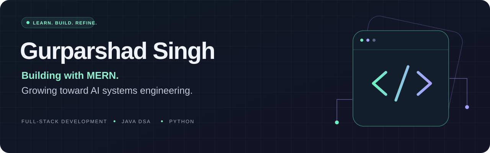

<!-- Profile presentation refreshed without deleting existing repository files. -->

  

  <a href="#featured-work"><b>Featured work</b></a> &nbsp; / &nbsp;
  <a href="#toolbox"><b>Toolbox</b></a> &nbsp; / &nbsp;
  <a href="#learning-direction"><b>Learning direction</b></a> &nbsp; / &nbsp;
  <a href="#repository-directory"><b>All public work</b></a>

## Hi, I'm Gurparshad 👋

I'm a student building full-stack web applications and strengthening my software fundamentals. My long-term goal is to become an **AI systems engineer** who can turn models into useful, reliable applications.

- **Building:** MERN applications, including Streamify, a place for engineering students and professionals to connect.
- **Practicing:** JavaScript, React, backend development, and data structures and algorithms in Java.
- **Exploring:** Python, with machine learning as my next learning step.
- **Open to:** learning together and collaborating on MERN projects.

## Featured work

<table>
<tr>
<td width="50%" valign="top">

### 01 / Wanderlust

**A full-stack listing application**

Listings, reviews, and user authentication in an Express application with server-rendered views.

`Node.js` `Express` `MongoDB` `EJS` `Passport`

[Explore the project →](https://github.com/GurparshadSingh/WANDER_LUST)

</td>
<td width="50%" valign="top">

### 02 / Full-stack development

**Projects, experiments, and practice**

My web-development workspace, including core exercises, GameVault backend work, and a Snake Game.

`Web development` `Projects` `Practice`

[Browse the collection →](https://github.com/GurparshadSingh/FULL_STACK_DEVELOPMENT)

</td>
</tr>
<tr>
<td width="50%" valign="top">

### 03 / Java DSA

**Building problem-solving fluency**

Practice across data structures and algorithms, including strings, linked lists, trees, and graphs.

`Java` `Data structures` `Algorithms`

[Read the solutions →](https://github.com/GurparshadSingh/Java_Data_Structure_and_Algorithms)

</td>
<td width="50%" valign="top">

### 04 / Python learning collection

**A foundation for the next chapter**

Python exercises and mini projects covering syntax, collections, functions, OOP, and file handling.

`Python` `OOP` `Mini projects`

[Explore the exercises →](https://github.com/GurparshadSingh/PYTHON-AI-PROJECTS-HANDBOOK)

</td>
</tr>
</table>

## Toolbox

Technologies I've used or am actively practicing:

| Area | Tools |
| :--- | :--- |
| **Languages** | JavaScript · Java · Python · C |
| **Frontend** | HTML · CSS · React · Tailwind CSS · Bootstrap 5 · DaisyUI |
| **Data & state** | TanStack Query · Zustand |
| **Backend** | Node.js · Express · REST APIs · authentication |
| **Databases** | MongoDB · Mongoose · MySQL |
| **Workflow & integrations** | Git · GitHub · Stream Chat SDK |

## Learning direction

**Stronger software foundations → Python & mathematics → ML fundamentals → AI systems**

Right now, I'm focusing on understanding the code I write: how data moves through an application, how asynchronous JavaScript works, and how to debug a feature from the browser to the database.

## Repository directory

A single place to explore more than the six pinned repositories.

| Repository | What you'll find |
| :--- | :--- |
| [Wanderlust](https://github.com/GurparshadSingh/WANDER_LUST) | Full-stack listing application |
| [Full-stack development](https://github.com/GurparshadSingh/FULL_STACK_DEVELOPMENT) | Web-development projects and exercises |
| [Java DSA](https://github.com/GurparshadSingh/Java_Data_Structure_and_Algorithms) | Java problem-solving practice |
| [Python handbook](https://github.com/GurparshadSingh/PYTHON-AI-PROJECTS-HANDBOOK) | Python learning material and mini projects |
| [Python practice](https://github.com/GurparshadSingh/PYTHON-PRACTICE-CODES) | Additional Python practice |
| [C programming](https://github.com/GurparshadSingh/C-PROGRAMMING) | C programming practice |

<b>Early-stage repositories / future work</b>

These repositories are starting points; they are not presented as completed projects.

- [AI_ML](https://github.com/GurparshadSingh/AI_ML) — space for my upcoming AI/ML work.
- [LEETCODE-](https://github.com/GurparshadSingh/LEETCODE-) — space for coding-problem practice.
- [Hackathon-work](https://github.com/GurparshadSingh/Hackathon-work) — space for hackathon work.

---

<b>Understand it. Build it. Make it better.</b>

<b>Original profile / badges, stats, and extras</b>

The earlier profile content is preserved below. An unchanged copy is also saved in [profile-history/README-before-refresh-2026-10-26.md](./profile-history/README-before-refresh-2026-10-26.md).

# 💫 About Me:
🔭 I’m currently working on FULL STACK PROJECT 👯 I’m looking to collaborate on MERN projects 🌱 I’m currently learning DSA and MERN ⚡ Fun fact When people cant match you they will hate  you

# 💻 Tech Stack:
              
# 📊 GitHub Stats:
 
 

### ✍️ Random Dev Quote

### 🔝 Top Contributed Repo

<!-- Proudly created with GPRM ( https://gprm.itsvg.in ) -->

